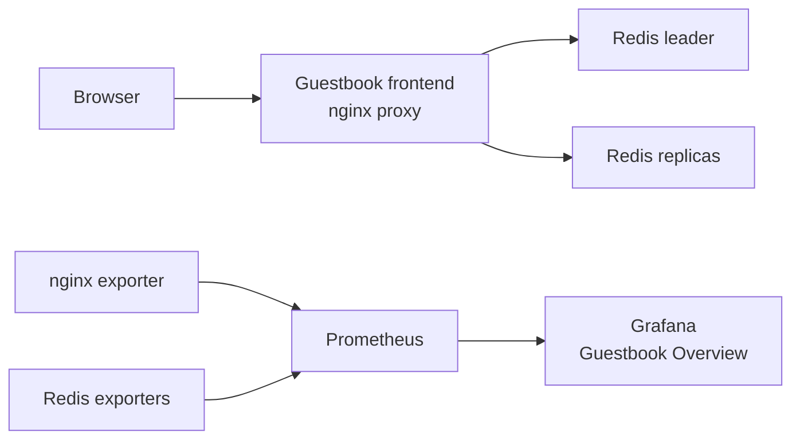

# guestbook monitoring with pulumi

This extends Pulumi's Kubernetes TypeScript Guestbook example with prometheus, grafana, and exporter metrics. Pulumi creates one namespace with the PHP Guestbook frontend, Redis leader and replicas, prometheus, and grafana.



Prometheus discovers annotated `metrics` EndpointSlice ports in this namespace only. It adds `job="guestbook"` and records `namespace`, `component`, `pod`, and `service`. Grafana uses the plugins in its pinned image, with plugin installs and updates disabled. The provisioned dashboard is **Guestbook Overview**, UID `guestbook-overview`, with a 15-second datasource interval.

## before you start

- Node.js 22 or newer and npm
- Pulumi CLI, logged in to the backend you want to use (the local example uses the local backend)
- `kubectl` configured for the target cluster
- An **amd64** Kubernetes cluster for the default frontend image

The original PHP 5 Guestbook training image is deprecated and pinned by digest for the exercise. It is amd64-only. On arm64, set `frontendImage` to a compatible image with the same Guestbook DNS contract. A native arm64 build or emulation is not assumed.

For local use, start a fresh minikube profile on an amd64 machine:

```sh
minikube start --profile guestbook
kubectl config get-contexts
```

Use the exact context name from `kubectl config get-contexts`. `kubernetesContext` is required, so Pulumi does not use the current context by accident.

## deploy locally

From this directory:

```sh
pulumi login --local
pulumi stack init dev
npm ci
npm run check
pulumi config set kubernetesContext guestbook
pulumi config set serviceType NodePort
pulumi up
```

Replace `guestbook` if your minikube context differs. `NodePort` is the default. Without `nodeAddress`, Pulumi reports `http://127.0.0.1:8080` for the app and `http://127.0.0.1:3000` for grafana. Start the port forwards below first.

Run each command in a separate terminal and leave it running. Restart port forwards after a rollout because they connect to a pod. Copy the command shown by Pulumi, don't use `eval` on output:

```sh
pulumi stack output guestbookPortForward
pulumi stack output prometheusPortForward
pulumi stack output grafanaPortForward
```

Then open the Guestbook and grafana URLs. Read the generated grafana credentials locally:

```sh
pulumi stack output grafanaUrl
pulumi stack output grafanaAdminUser
pulumi stack output grafanaAdminPassword --show-secrets
```

The default username is `admin`. A random password is generated unless `grafanaAdminPassword` is set as a Pulumi secret.

## deploy to a cloud cluster

Make sure the cloud context is in kubeconfig, then set it explicitly:

```sh
pulumi login
pulumi stack init cloud-demo
npm ci
npm run check
pulumi config set kubernetesContext <cloud-context>
pulumi config set serviceType LoadBalancer
pulumi up
pulumi stack output guestbookUrl
pulumi stack output grafanaUrl
```

`LoadBalancer` can create **two billable load balancers**, one for Guestbook and one for grafana. Pricing, allocation time, and public IP behaviour depend on the provider and account, so check those before using it. These are plain HTTP demo endpoints. Restrict access, use a private cluster or tunnel for a demo, and don't expose this as a public production setup.

## configuration

| key | default | what it does |
| --- | --- | --- |
| `kubernetesContext` | required | exact kubeconfig context used by the Pulumi Kubernetes provider |
| `namespace` | `guestbook-<stack>` | namespace name, must be a valid Kubernetes DNS label |
| `serviceType` | `NodePort` | `NodePort` or `LoadBalancer` |
| `nodeAddress` | unset | host or IP used to form NodePort URLs, otherwise port forwards are needed |
| `frontendReplicas` | `3` | number of frontend pods, positive integer |
| `redisReplicas` | `2` | number of Redis replica pods, positive integer |
| `frontendImage` | pinned upstream PHP Guestbook image | compatible replacement image, for example on arm64 |
| `grafanaAdminPassword` | generated secret | optional grafana password, set with `pulumi config set --secret grafanaAdminPassword` |

Useful outputs are `namespace`, `guestbookUrl`, `grafanaUrl`, `grafanaAdminUser`, `grafanaAdminPassword` (secret), the three port-forward commands, `grafanaNodePort`, and `expectedApplicationTargets`.

## check metrics and grafana

After starting the port forwards, open prometheus at `http://127.0.0.1:9090/targets`. With defaults, the `guestbook` job should have **six** `UP` targets: three frontend exporters, one Redis leader exporter, and two Redis replica exporters. If replicas change, the total is `frontendReplicas + 1 + redisReplicas`, also exported as `expectedApplicationTargets`.

Useful prometheus queries:

```promql
up{job="guestbook"}
nginx_up{job="guestbook"}
redis_up{job="guestbook"}
rate(nginx_http_requests_total{job="guestbook"}[1m])
rate(redis_commands_processed_total{job="guestbook"}[1m])
redis_memory_used_bytes{job="guestbook"}
```

Redis command rate includes exporter polling, so it can be nonzero before app traffic. Nginx counts include exporter stub-status requests, so this is proxy traffic rather than just end-user requests. TCP probes do not add HTTP traffic. The dashboard has request rate and active connections. This training app has no error-rate or CPU metrics.

Sign in with the Pulumi outputs and open **Guestbook / Guestbook Overview**. It has target health, nginx exporter health, request rate, active connections, Redis command rate, Redis memory, and Redis health. Use Namespace when prometheus scrapes more than one Guestbook namespace.

For a smoke check after starting local port forwards:

```sh
GUESTBOOK_URL=http://127.0.0.1:8080 \
PROMETHEUS_URL=http://127.0.0.1:9090 \
GRAFANA_URL=http://127.0.0.1:3000 \
npm run verify
```

`EXPECTED_TARGETS` defaults to `6`, set it if replica counts differ. `GRAFANA_PASSWORD` is optional. Read it with `pulumi stack output grafanaAdminPassword --show-secrets` when the verifier needs to authenticate:

```sh
GRAFANA_PASSWORD="$(pulumi stack output grafanaAdminPassword --show-secrets)" npm run verify
```

The verifier writes a test value to Redis key `monitoring-verification`, reads it through the app, sends 50 requests, and checks the frontend counter increases. With `GRAFANA_PASSWORD`, it also checks admin auth and the provisioned datasource/dashboard. It does not print the password.

`npm run check` runs TypeScript checks and Pulumi mock tests. `npm run verify` checks live endpoints, so it needs a deployed cluster and reachable URLs.

## limits and cleanup

The default NodePort path adds no cloud load balancers and asks for no persistent volumes. Cluster compute, node storage, network, and cluster management charges still apply. Check provider, region, and account pricing before choosing LoadBalancer. Local testing uses local CPU, RAM, disk, and bandwidth.

Redis, prometheus, and grafana use ephemeral storage. Prometheus keeps at most 24 hours or 512 MB. A restart or redeploy can lose metric history, dashboard UI changes, and other runtime state.

Destroy only the stack and cluster/profile created for this exercise:

```sh
pulumi destroy
pulumi stack rm
minikube delete --profile guestbook
```

Don't delete a minikube profile you did not create for this project.

## validation performed

Validated on 28 October 2026 with Node.js 24.1.0, Pulumi 3.272.0, and an isolated minikube Kubernetes 1.27.3 cluster on Docker Desktop. The test host was arm64 with working amd64 emulation for the original PHP image. This is not native arm64 support. Use a supported Kubernetes release for your own deployment.

- `npm run check`: TypeScript and both Pulumi mock/helper tests passed.
- `pulumi up`: 24 resources created, all five Deployments rolled out after the final configuration update.
- `pulumi preview --expect-no-changes`: 24 resources unchanged.
- `promtool check config` and `nginx -t`: passed inside their running containers.
- Live verifier: six distinct scrape targets healthy, nginx and Redis reachable through their exporters, Guestbook write/read through Redis replication worked, 50 generated requests appeared in the counter, Redis metrics were present, grafana admin login and datasource health worked, and every dashboard query returned data.
- NodePort plus port-forward access was tested. Cloud LoadBalancer provisioning was not tested.

The temporary validation cluster was removed after testing. The URLs above work after you deploy your own stack and start its port forwards.

## project layout

- `index.ts`: application, exporters, monitoring resources, and stack outputs
- `config/`: NGINX proxy and Prometheus discovery configuration
- `dashboards/guestbook.json`: the provisioned Grafana dashboard
- `tests/`: Pulumi mock and helper checks
- `scripts/verify.mjs`: end-to-end application and monitoring checks
- `package-lock.json`: exact Node dependency tree for `npm ci`

## references

- [Pulumi Kubernetes Guestbook example](https://github.com/pulumi/examples/tree/master/kubernetes-ts-guestbook)
- [Pulumi Kubernetes provider](https://www.pulumi.com/registry/packages/kubernetes/)
- [Kubernetes service types](https://kubernetes.io/docs/concepts/services-networking/service/#publishing-services-service-types)
- [kubectl port-forward](https://kubernetes.io/docs/reference/kubectl/generated/kubectl_port-forward/)
- [Prometheus configuration](https://prometheus.io/docs/prometheus/latest/configuration/configuration/)
- [Grafana provisioning](https://grafana.com/docs/grafana/latest/administration/provisioning/)
- [NGINX Prometheus exporter](https://github.com/nginx/nginx-prometheus-exporter)
- [Redis exporter](https://github.com/oliver006/redis_exporter)
